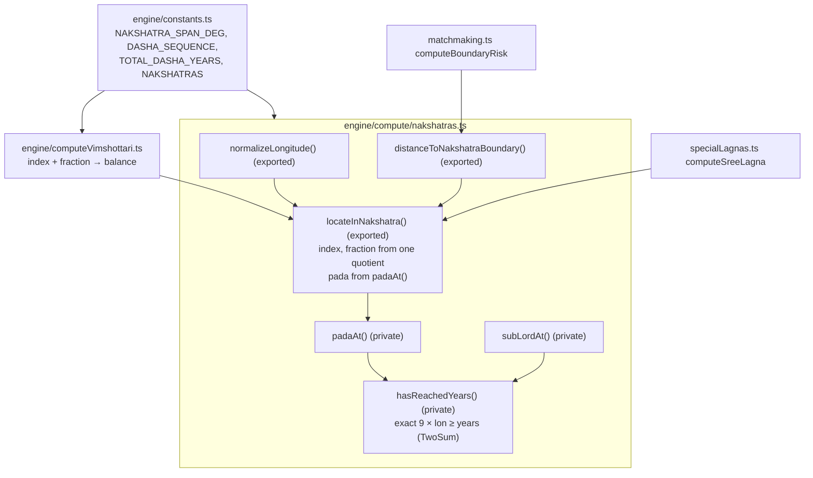

# Design Document: One Nakshatra Locator for the Whole Engine

## Overview

`engine/compute/nakshatras.ts` exports the locator it already used internally.
`computeVimshottari`, matchmaking's `computeBoundaryRisk` and the Sree Lagna take
their nakshatra position from it instead of their own `% span`. Pada and sub-lord
are decided by one exact comparison. `nakshatras.ts` reads its tables from
`engine/constants.ts`. The four lossy `normLong` helpers are measured and left in
place.

## Guiding Principle

- **One place does nakshatra arithmetic.** Every index, fraction, pada, sub-lord
  and boundary distance comes from `nakshatras.ts`.
- **Never mix a rounded quotient with an exact remainder.** `360 / 27` rounds up,
  so `floor(lon / span)` and `lon % span` disagree at an exact boundary.
- **Every discrete cut is a whole number of dasha years** (9 per degree): a
  nakshatra starts at 120 × index, padas follow every 30 years, sub-lords at the
  cumulative lord years. Pada and sub-lord compare `9 × lon` with that integer,
  exactly.

## Architecture / Affected Modules

**Import graph (checked):** `constants.ts` has only a type import (`@/lib/types`).
`nakshatras.ts` imports values from `../constants`; `computeVimshottari.ts` from
`./constants`, `@/lib/errors` (no imports) and `./compute/nakshatras`. Nothing under
`engine/compute/` imports `computeVimshottari.ts`. No cycle; `charaDasha.ts`
already imports `../constants` the same way.

## Locator

| Export | Contract |
|---|---|
| `normalizeLongitude(lon)` | [0, 360); an in-range value is returned unchanged; −0 → 0; a tiny negative that rounds to 360 → 0; NaN → NaN |
| `locateInNakshatra(lon)` → `NakshatraLocation` | `normalizedLong`; `nakshatraIndex = floor(q)`, `fraction = q − index` with `q = normalizedLong / NAKSHATRA_SPAN_DEG` (exact subtraction, so fraction ∈ [0, 1)); `pada` from `padaAt()`. NaN → NaN index, fraction and pada |
| `distanceToNakshatraBoundary(lon)` | degrees to the nearer edge of the located nakshatra, ≥ 0; NaN → NaN |

`getNakshatraIndex`, `getPada`, `computeSubLord` and `computeNakshatraForLongitude`
all go through `locateInNakshatra`, as before. `NakshatraLocation` lives in
`nakshatras.ts`, not `types.ts` (owned by another change).

## Pada and Sub-Lord

In Mars-led (Mrigashira, Chitra, Dhanishtha) and Mercury-led (Ashlesha, Jyeshtha,
Revati) nakshatras the 60-year sub-lord cut is the start of pada 3. Before this
change pada came from `floor(fraction × 4) + 1` and the sub-lord from comparing the
longitude with the double nearest `years / 9`. Two different roundings, so a
double right at that cut could get an impossible pair.

Three rules were measured against a BigInt oracle (exact `9 × lon ≥ years` on the
double's mantissa) on every double within ±200 ulps of all 319 cut points
(127,518 doubles; pada and sub-lord compared where the index is exact, which is
all but one):

| Rule | Pada wrong | Sub-lord wrong | Impossible pairs |
|---|---|---|---|
| `main` (index from `floor`, position from `lon % span`); independent review, index also wrong 25 times | 164 | 652 | — |
| Baseline (branch's earlier fix): pada from fraction, sub-lord vs rounded cut | 6 | 105 | 1 (353.3333333333333: Revati pada 2 with the Mars sub) |
| P: pada and sub-lord both vs the rounded cut double | 26 | 105 | 0 |
| **E: both by exact `9 × lon ≥ years` (chosen)** | **0** | **0** | **0** |

The 105 sub-lord errors are each a double that *is* the rounded cut while the true
cut lies a hair above it (3.6666666666666665 read as the Moon sub instead of the
Sun). P would make the pairs agree by making pada as wrong as the sub-lord. E makes
both exact, so the pairs cannot disagree.

`hasReachedYears(lon, years)`: `8 × lon` is exact, `sum = 8·lon + lon` is
`9 × lon` rounded, and Knuth's TwoSum recovers that rounding error exactly.
Rounding is monotonic, so `sum > years` or `sum < years` settles it, and only a tie
(`sum === years`) needs the sign of the error. In the sweep it agreed with the
BigInt oracle on every call.

`padaAt` counts the pada cuts (30, 60, 90 years in) the longitude has reached,
within the nakshatra the quotient chose, so pada is always 1–4 and consistent with
the index. NaN keeps a NaN pada (`getPada(NaN)` must stay NaN so matchmaking
reports the koota unavailable). Within an ulp of a pada cut the pada can now differ
from `floor(fraction × 4) + 1`; nothing reads the two together.

Every 4-decimal longitude still matches the exact integer oracle: index, pada,
sub-lord, degree in nakshatra, and matchmaking's nakshatra/pada/rashi. The test
(`tests/nakshatra-pada-boundary.test.ts`) covers ±0.005° around every whole degree
and boundary; an exhaustive scratch run over all 3.6 million found 0 mismatches,
both for the branch's earlier boundary fix (the baseline below) and for this
change. `main` fails the same oracle, e.g. at 40°.

## Vimshottari

`computeVimshottari` takes `{ nakshatraIndex, fraction }` from `locateInNakshatra`
and drops its own `getNakshatraIndex` and `lon % span`. Nothing else changes.

- **Out-of-range input (decided in review follow-up 7.1).** The input check is now
  `!(lon >= 0 && lon <= 360)` → `DashaIntegrityError`. 360 is accepted and the
  locator reads it as 0°: `Decimal(8,4)` rounds a Moon in [359.99995°, 360°) up to
  360.0000, which previously made the analyze route return a 500. The tree is
  identical to the one for 0° (a full Ketu MD; the true tree has at most 34 minutes
  of Mercury balance first). −0 becomes 0, which gives the identical tree.
- **NaN** now fails the input check with `DashaIntegrityError`. It used to pass
  the check and throw a `TypeError` on the `DASHA_SEQUENCE[NaN]` lookup.
- `tests/vimshottari-nakshatra-boundary.test.ts` is a byte-for-byte copy (`cmp`) of
  the file on `claude/youthful-chebyshev-d9d035`. Before the fix 27 of its 63 tests
  fail; after it all 63 pass.

## Boundary Risk

`computeBoundaryRisk` now calls `distanceToNakshatraBoundary(moonLongitude)`; the
function body and the `./nakshatras` import line are the only changes in
`matchmaking.ts`. The distance is measured from the located nakshatra's cut points,
`(120 × index) / 9` and `(120 × (index + 1)) / 9` degrees: the doubles nearest the
true boundaries, exactly the boundary when it is a whole degree. Inside the
nakshatra the subtraction is exact (Sterbenz), and a longitude the quotient placed an
ulp outside those doubles gets 0.

Formulas measured against the exact `atRisk` (distance ≤ 1°, inclusive) for all
3.6 million 4-decimal longitudes:

| Formula | `atRisk` wrong | Example |
|---|---|---|
| Before: `normalized % span`, `min(pos, span − pos)` | 9 | 39.0000 → 1.0000000000000018, not at risk |
| `min(fraction, 1 − fraction) × span` | 6 | 39.0000 → 1.0000000000000024 |
| **Located nakshatra's cut points (chosen)** | **0** | 39.0000 → 1 |

The 9 that change are 39, 79, 119, 159, 199, 239, 279, 319 and 359.0000: each is
exactly 1° below a whole-degree boundary, so `atRisk` goes from false to true.

The module-level `const NAKSHATRA_SPAN_DEG = 360 / 27` in `matchmaking.ts` is now
unused. It sits outside this change's edit region, so it is left for the owner of
that file to delete (tasks.md 6.3). `tsc` and ESLint do not flag it.

## Sree Lagna

`computeSreeLagna` takes `fraction` from `locateInNakshatra(moonLongitude)` in place
of `normLong(moon) % span / span`, and still wraps the result with the module's
`normLong`. A Moon exactly on a boundary now gives fraction 0. Before, it gave
≈ 1 − 1e-16, so Sree Lagna came back ~6e-14° below the Lagna: invisible unless the
Lagna sits exactly on a sign cusp (Lagna 30°: Aries 29.99999999999994° before,
Taurus 30° now). The test pins that case.

## Shared Constants

`nakshatras.ts` now imports `NAKSHATRA_SPAN_DEG` (the same expression, `360 / 27`,
so the same double), `DASHA_SEQUENCE`, `TOTAL_DASHA_YEARS` and `NAKSHATRAS` from
`engine/constants.ts`. `NAKSHATRA_DATA` is built from `NAKSHATRAS` as
`{ name, lord }` copies, so `getNakshatraData()` keeps its exact shape (equal JSON
before and after, checked) and its callers cannot mutate the shared table.
`getNakshatraData()` has no callers in the repo today; `getNakshatraLord` /
`getNakshatraName` (used by `jaimini.ts` and `matchmaking.ts`) read the same table.

## Lossy Normalizations

`normLong = ((lon % 360) + 360) % 360` rounds every in-range longitude onto the
2⁻⁴⁴° (below 152°) or 2⁻⁴³° grid of [360, 720). Only 33% of random in-range doubles
pass through unchanged; the rest move by up to 5.7e-14°. Inputs in [−360, 0) and
[360, 720) come out identical either way.

Each copy was swapped for `normalizeLongitude` in a scratch variant and swept:

| File | Sample | Emitted values that change | Discrete changes (sign, house) | Decision |
|---|---|---|---|---|
| `upagrahas.ts` | 200,000 charts | 73% of charts (all five solar upagrahas, Gulika, Mandi) | 0 | **Leave** |
| `specialLagnas.ts` | 200,000 × 2 | 83% of charts (HL, GL, BL, SL, KL, BBL, PL) | 0 | **Leave** |
| `transits.ts` | 150 `computeTransits` calls | 877 of 1,500 planet rows; `sadeSatiByDegree.separationDeg` 61 times; one `durationDays` | 0 | **Leave** |
| `gochar.ts` | 40 ranges (with Moon), 4,664 intervals; 100,000 samples | `computeGocharRange`: none. Exported `getSiderealLongitude().longitude`: 69% | 0 | **Leave** |

None of the four does nakshatra arithmetic, and each emits longitudes that would
change in their last bits, which the rule for this task forbids. `gochar.ts` is the
only one whose public output (`/api/gochar` intervals) did not change. Its exported
`getSiderealLongitude` (used by the cusp-proximity tests and `stepIsSafe`) did, so
it is left too (Open Questions).

## Measured Drift

**Baseline.** All sweeps compare a snapshot of each file taken before this change
with the changed file. That snapshot already held the branch's earlier boundary fix
to `nakshatras.ts`, so it is not `main`. Against `main`, an independent review
measured the same zero changes in index, pada, sub-lord, mahadasha lord, Sree Lagna
sign and `atRisk` away from boundaries; `degreeInNakshatra` differs in its last
bits in 96% of values (≤ 8e-14°), because `main` computed it as `lon % span`. The
sweeps ran on Node 20, bundled with esbuild (scratch scripts in the session
scratchpad, not the repo). "Uniform" draws `Math.random() × 360`, which keeps a
full mantissa. "4-decimal" draws `k / 10000`.

| Function | Sample | Discrete outputs changed | Continuous outputs |
|---|---|---|---|
| `computeNakshatraForLongitude`, `getNakshatraIndex`, `getPada`, `computeSubLord` | 20M uniform + 2M in [−720, 1080) + 2M log-uniform | **0** | `degreeInNakshatra` bit-identical to the baseline in all 24M (vs `main`: last-bit differences, ≤ 8e-14°) |
| same, near cuts | ±200 ulps of 319 cuts (127,518) | 105 sub-lords, 6 padas; every one moves to the BigInt oracle's answer | — |
| `getNakshatraData()` | — | identical JSON | — |
| `computeVimshottari` | 400,000 uniform | MD lords: **0** | `balance_years` bits differ in 86% (≤ 3.6e-14 years ≈ 1.1 µs); some period instant moves in 202 trees (0.05%), by 1 ms (191) or 2 ms (11) |
| `computeVimshottari` | 400,000 4-decimal | MD lords: **0** (no exact boundary drawn) | instants move in 4,407 trees (1.1%), mostly by 1 ms, at most 9 ms |
| `computeVimshottari` vs `getNakshatraPosition` (other branch) | 400,000 uniform + 400,000 4-decimal + 5,354 within ±50 ulps of every boundary | **identical**: every `balance_years` bit and every instant | — |
| `computeBoundaryRisk` | 2M uniform + 1M in [−720, 1080) + 1M log-uniform | `atRisk`: **0** | `distanceToBoundaryDeg` differs by ≤ 9.1e-14° (bit-identical in 3%) |
| `computeBoundaryRisk` | all 3.6M 4-decimal | `atRisk`: the 9 threshold-edge values above, now exact | max error vs exact 4.8e-14° |
| `computeSpecialLagnas` | 200,000 uniform Moon + 200,000 4-decimal Moon | **0** (all sign, house) | SL longitude differs in 95%, by ≤ 2.3e-12° (most of it the old lossy Moon normalization) |

The Vimshottari instant drift needs explaining. Each period end is `addDays`
truncated to a millisecond, and the next period starts there, so a ~1 µs change in
the balance flips a truncation now and then, and the flips add up along the birth
MD's 9 ADs and 81 PDs. 4-decimal longitudes give "round" balances (259.4800° →
10.78 years) whose instants sit near whole milliseconds, so they flip more often.
The other branch's arithmetic is the same, bit for bit, so this drift comes with
either fix. Stored `UnifiedChart.dashaTree` rows are not recomputed; the analyze
route recomputes its tree on every run.

## Alternatives Considered

| Alternative | Why not |
|---|---|
| Fraction from the exact remainder, `(lon % span) / span`, with index from the quotient and the one inconsistent case (quotient rounded up to an integer, remainder ≈ span) set to 0 | Zero drift away from boundaries, and about 5 bits more accurate. But it replaces the one-quotient rule the parent fix and the other branch both adopted, with a reconciliation step. The drift it avoids is ≤ 1.1 µs in the balance. Not adopted. |
| Index from the exact `9 × lon ≥ 120 × index` test too | Would make the index exact at the one double in the sweep where the quotient is wrong (Known Limitations). But the fraction would then need recomputing, or it can reach 1.0 (`q = 17.0` with exact index 16). Out of scope. |
| Boundary distance as a field of `NakshatraLocation` | Only matchmaking needs it; a separate function keeps the locator's shape as specified. |
| Replace every lossy `normLong` | Changes emitted longitudes in 58–83% of inputs (Lossy Normalizations). |

## Merge Notes

Branch `claude/youthful-chebyshev-d9d035` (uncommitted) fixes the same Vimshottari
bug with a private `getNakshatraPosition()` in `computeVimshottari.ts`.

- **Keep this branch's `engine/computeVimshottari.ts`.** It supersedes
  `getNakshatraPosition`: same quotient, same double (`NAKSHATRA_SPAN_DEG`), so its
  output is bit-identical (Measured Drift), but it goes through the shared locator.
- **`tests/vimshottari-nakshatra-boundary.test.ts` is identical** on both branches;
  either copy can be kept.
- Both branches add a "Birth nakshatra and balance" paragraph to `docs/HLD.md` §3.5
  and a bullet to `skills/backend/pre-analysis.md`. Keep this branch's wording,
  which names `locateInNakshatra()`. The `docs/RELEASE_NOTES.md` entries are
  proposed to the parent, not written here.

## Known Limitations

- **Index within an ulp of a boundary.** The index is `floor(q)`, and `q` is
  rounded. One double in the near-cut sweep gets the next nakshatra:
  226.66666666666666 reads as Jyeshtha (17) while it lies a hair inside Anuradha
  (16). Fraction, pada and sub-lord stay consistent with the index it picks
  (fraction 0, pada 1, first sub-lord). Unchanged from the parent fix. No 4-decimal
  longitude is affected.
- **Boundary distance** is exact relative to the nearest double to the boundary, so
  it can be off by up to half an ulp of that boundary (≤ 3e-14°).
- **Sree Lagna and the other special lagnas** still pass through the lossy
  `normLong`, so a Sree Lagna for a boundary Moon equals `normLong(lagna)`, which
  can differ from the Lagna in its last bits.

## Open Questions

1. **Stored `moonLongitude` of 360.0000. Resolved (task 7.1):** `computeVimshottari`
   accepts 360 and reads it as 0° (see Vimshottari above).
2. **NaN Moon. Resolved (task 7.1):** rejected with `DashaIntegrityError`.
3. **`gochar.ts`'s `normLong`** could be swapped without changing `/api/gochar`
   output (none in 4,664 intervals), at the cost of last-bit changes in the exported
   `getSiderealLongitude`. Left as is.
