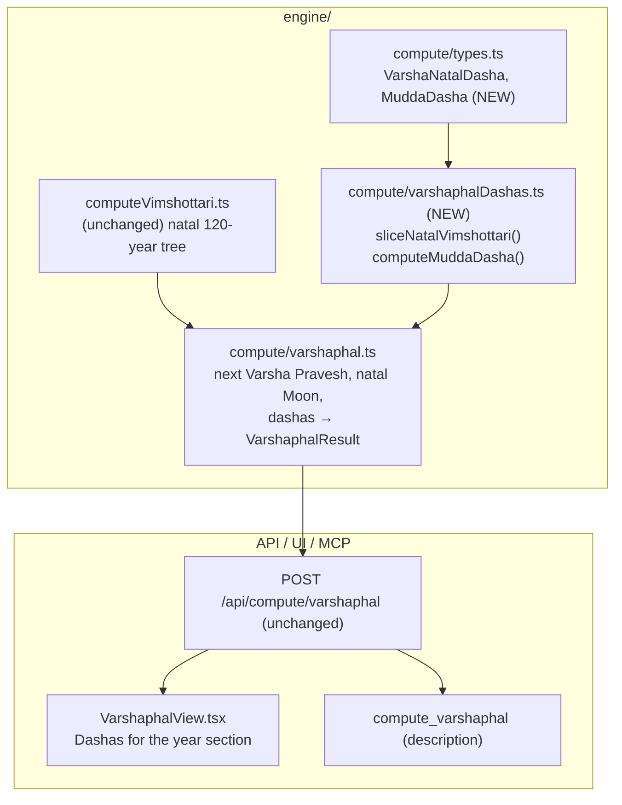

# Design Document: Varshaphal Dashas (Natal Vimshottari + Tajika Mudda)

## Overview

A new pure module `engine/compute/varshaphalDashas.ts` holds two functions:

- `sliceNatalVimshottari(tree, yearStart, yearEnd)` — reads the periods of an existing
  natal Vimshottari tree that overlap the Varsha year.
- `computeMuddaDasha(natalMoonLongitude, age, yearStart, yearEnd)` — lays out the
  Vimshottari sequence compressed into the Varsha year.

`computeVarshaphal` finds the next Varsha Pravesh, builds the natal tree with
`computeVimshottari`, calls both, and returns them as `VarshaphalResult.dashas`. The
route and MCP tool pass the field through; the Varshaphal tab renders it.

## Architecture / Affected Modules



## Data Models

Added to the Varshaphal section of `engine/compute/types.ts`. All dates are ISO-8601
UTC strings.

```ts
export interface VarshaNatalAntardasha { mahadasha: string; antardasha: string; start: string; end: string }
export interface VarshaNatalPratyantardasha extends VarshaNatalAntardasha { pratyantardasha: string }

export interface VarshaNatalDasha {
  atVarshaPravesh: { mahadasha: string; antardasha: string; pratyantardasha: string } | null
  antardashas: VarshaNatalAntardasha[]          // overlapping the year, true bounds
  pratyantardashas: VarshaNatalPratyantardasha[]
}

export interface MuddaAntardasha { lord: string; start: string; end: string; days: number }

export interface MuddaDashaPeriod {
  lord: string
  start: string
  end: string
  days: number
  portion: 'full' | 'balance' | 'remainder'
  antardashas: MuddaAntardasha[]
}

export interface MuddaDasha {
  janmaNakshatra: string
  janmaNakshatraNumber: number   // 1–27, Ashwini = 1
  startLord: string
  balanceFraction: number        // 0–1
  yearStart: string
  yearEnd: string
  yearDays: number
  periods: MuddaDashaPeriod[]
}

// VarshaphalResult gains:
//   dashas: { natalVimshottari: VarshaNatalDasha; mudda: MuddaDasha }
```

## Natal Vimshottari Slice

`computeVarshaphal` already has the natal Julian Day and computes the natal Moon with
`computePlanetPositions`. The UTC birth instant is `julianDayToUtcISO(natalJulianDay)`,
the same instant `/api/compute` builds with `Date.UTC(local) − timezone`, so the tree
matches the Dasha tab.

`sliceNatalVimshottari` walks MD → AD → PD and keeps every AD and PD with
`start < yearEnd && end > yearStart`. The chain at the Varsha Pravesh is the MD, AD and
PD with `start ≤ yearStart < end`. Bounds are not clipped. Outside the tree the chain is
`null` and the lists are empty.

## Mudda Dasha

1. `n` = natal Moon nakshatra index (0–26) = `floor(lon / 13°20′)`; Janma number `n + 1`.
2. Starting lord = `DASHA_SEQUENCE[(n + age) % 9]`. This is the classical
   `(N + age − 2) mod 9` rule rewritten for the Ketu-first `DASHA_SEQUENCE`: remainder
   `r` maps to sequence index `(r + 1) mod 9`.
3. `balanceFraction = 1 − (lon mod 13°20′) / 13°20′`.
4. `yearDays = (yearEnd − yearStart)` in days; `perYear = yearDays / 120`.
5. Lay out a virtual run that starts `(1 − balanceFraction) × startYears × perYear` days
   before `yearStart`: the starting lord's full period, the next eight lords, then the
   starting lord again. Each virtual period gets nine Vimshottari antardashas from its
   own lord.
6. Clip every period and antardasha to `[yearStart, yearEnd]` and drop anything of zero
   length. The first period becomes the `balance`, the tenth the `remainder`.

Because the nine distinct lords sum to 120 years, the window ends inside the tenth
period at exactly the elapsed offset, so the periods tile the year with no gap.

### Worked example (proportions)

With a 360-day year, `perYear` is 3 days: Ketu 21, Venus 60, Sun 18, Moon 30, Mars 21,
Rahu 54, Jupiter 48, Saturn 57, Mercury 51 — the classical Mudda table. A real
Varsha year is about 365.26 days, so each share is about 1.46% longer.

For a natal Moon one quarter through Rohini (Moon's nakshatra, number 4) at age 0, the
year opens with the Moon (`(4 + 0 − 2) mod 9 = 2`) for 75% of 30 days, runs Mars to
Sun in full, and closes with the remaining 25% of the Moon.

## computeVarshaphal Changes

- Next Varsha Pravesh: `findSolarReturnJulianDay(natalSun, returnJD + 365.25636)`.
- Natal tree: `computeVimshottari(natalMoon.longitude, new Date(julianDayToUtcISO(natalJD)))`.
- `dashas = { natalVimshottari: sliceNatalVimshottari(...), mudda: computeMuddaDasha(...) }`.
- The `method` note adds the dasha conventions.

## UI (`VarshaphalView.tsx`)

A "Dashas for the Year" section with two cards:

- **Natal Vimshottari** — "At Varsha Pravesh: MD / AD / PD", then a table of the
  overlapping antardashas (MD, AD, start, end), the row running at the Varsha Pravesh
  highlighted, and a `<details>` with the pratyantardashas.
- **Mudda Dasha** — Janma nakshatra, starting lord and balance, then one `<details>`
  row per period (lord, start, end, days, balance/remainder badge) opening onto its
  antardashas.

Dates are shown in the birth timezone (`form.timezone`), matching the Varsha Pravesh
time. Existing colours and table styles are reused.

## Error Handling

- `computeMuddaDasha` clamps nothing and never throws for valid inputs; a non-positive
  year length yields no periods.
- `sliceNatalVimshottari` returns `null` and empty lists outside the tree.
- `computeVimshottari` validates its own input; the natal Moon longitude is always in
  0–360.

## Testing Strategy

- **`engine/compute/varshaphalDashas.test.ts`** (co-located, no ephemeris):
  - starting lord against the classical formula for 27 nakshatras × ages 0–40;
  - age 0 equals the natal nakshatra lord and the natal balance;
  - periods tile the year, follow Vimshottari order, full periods have the right
    length, balance + remainder = the starting lord's full share, and a 360-day year
    gives the classical table;
  - a Moon at the very start of a nakshatra gives nine periods and no remainder;
  - antardashas tile each period and a full period starts with its own lord;
  - the natal slice against a `computeVimshottari` tree: overlap, order, chain at the
    Varsha Pravesh, and an out-of-range year.
- **`tests/varshaphal.test.ts`** (real chart): the Mudda year runs from this Varsha
  Pravesh to the next year's; the starting lord advances one Vimshottari step a year;
  the natal chain at the Varsha Pravesh matches the tree `/api/compute` would build.

## Documentation (Requirement 7)

`docs/computation_varshaphal.md` (§2 Dashas row, a new Dashas section, §7 open items),
`docs/HLD.md` (engine tree), `docs/DFD.md` (P8.4), `skills/backend/compute-engine.md`
(module row), `skills/backend/api-routes.md` (route output),
`.kiro/skills/nextjs-project-structure.md` (tree), `Claude.md`, `docs/RELEASE_NOTES.md`,
`mcp/src/tools.ts` (description).
