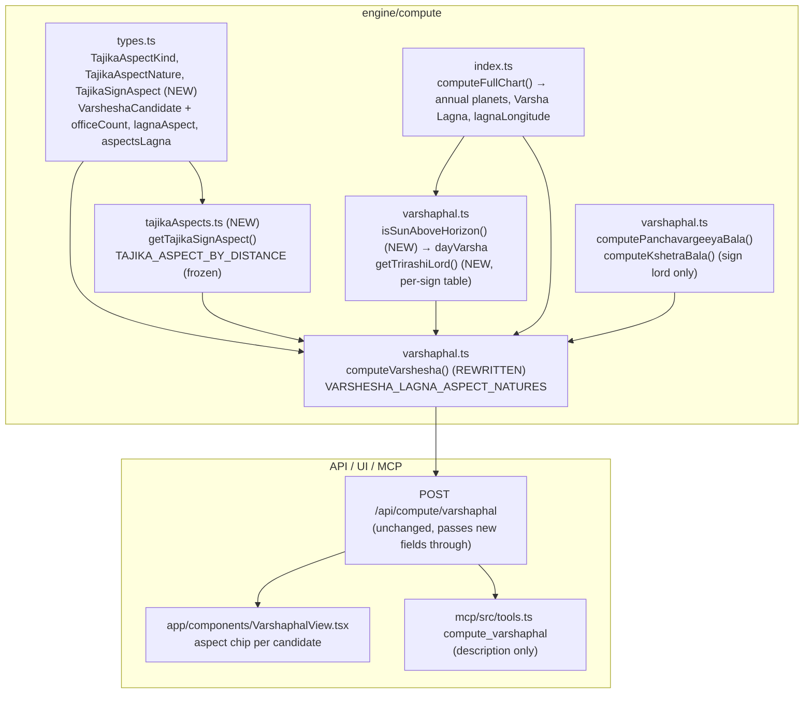

# Design Document: Strength-First, Lagna-Aspect-Aware Varshesha (Phase 1 Tajika Aspects)

## Overview

This feature changes how the Varshaphal engine picks the year lord. A new pure module
`engine/compute/tajikaAspects.ts` answers one question: are two signs in Tajika aspect,
and if so, which kind? `computeVarshesha` in `engine/compute/varshaphal.ts` uses it to
keep only the office-holders that aspect the Varsha Lagna, then takes the strongest by
Panchavargeeya Bala (PV). Office count drops from the primary key to a tie-break.

The change is additive at the API boundary: three new fields per candidate, two new
fields on the winner, and a rewritten `method` note. No route, DB or MCP tool shape
changes.

It also fixes how the engine decides whether the year begins by day or night.
That decision picks two of the five office-holders, and it was read from
whole-sign houses, which are wrong near sunrise and sunset (see Day/Night of the
Varsha Pravesh).

Aspects are **sign-based only** (Phase 1). Deeptamsha orbs and applying/separating
motion are Phase 2 and extend the same module.

## Guiding Principle (Tajika Neelakanthi)

- **Strength first.** PV decides among qualifying candidates; office count only breaks
  ties.
- **Lagna aspect qualifies.** A candidate must aspect the Varsha Lagna by a Tajika
  aspect. Sitting in the Lagna counts: Tajika pairs the conjunction with the
  opposition as the open inimical aspect (Requirement 9).
- **Tajika aspects are not Graha Drishti.** They are mutual and decided by sign
  distance (1/7, 3/11, 5/9, 4/10). The Parashari tables in `relationships.ts` (7th for
  all, plus special aspects for Mars/Jupiter/Saturn) are not reused.
- **Unverified choices stay visible.** Counting inimical aspects, the
  strongest-of-five fallback, the Sagittarius night Trirashi lord and the PV
  friendship/Drekkana conventions are documented as open (Requirement 7).
- **Geometry and policy are separate.** `tajikaAspects.ts` only says which aspect
  two signs form. Which aspects count for the year lord is a Varshesha rule and
  lives in `varshaphal.ts`.

## Architecture / Affected Modules



## Data Models

Added to the Varshaphal section of `engine/compute/types.ts`:

```ts
export type TajikaAspectKind = 'conjunction' | 'sextile' | 'trine' | 'square' | 'opposition'
export type TajikaAspectNature = 'friendly' | 'inimical'

export interface TajikaSignAspect {
  kind: TajikaAspectKind
  nature: TajikaAspectNature
  /** Inclusive sign count from the aspecting sign (same sign = 1): 1, 3, 4, 5, 7, 9, 10 or 11. */
  distance: number
}

export interface VarsheshaCandidate {
  // …existing: office, planet, officeLabel, panchavargeeyaBala
  officeCount: number                    // NEW — tie-break only
  lagnaAspect: TajikaSignAspect | null   // NEW — raw aspect, null when none
  aspectsLagna: boolean                  // NEW — whether that aspect counts
}

// VarshaphalResult.varshesha gains:
//   lagnaAspect: TajikaSignAspect | null
//   selectionBasis: 'aspects_lagna' | 'no_candidate_aspects_lagna'
```

The stale doc comment on `varshesha` ("strongest candidate by Panchavargeeya Bala"),
which never matched the old office-count code, is replaced by the new rule.

## Aspect Engine (`tajikaAspects.ts`)

| Sign distance | Kind | Nature |
|---|---|---|
| 1 | conjunction | inimical (open, with the 7th) |
| 3, 11 | sextile | friendly |
| 5, 9 | trine | friendly |
| 4, 10 | square | inimical |
| 7 | opposition | inimical |
| 2, 6, 8, 12 | — (`null`) | — |

- `TAJIKA_ASPECT_BY_DISTANCE` holds the table above.
- `getTajikaSignAspect(fromSign, toSign)` computes
  `distance = ((toSign − fromSign + 12) % 12) + 1` and looks it up. The table is
  symmetric (1↔1, 3↔11, 5↔9, 4↔10, 7↔7), so the aspect is mutual by construction.
- Non-integer or out-of-range input returns `null`; the function never throws.
- The table and each entry are `Object.freeze`d, and the function returns a copy, so
  a caller cannot change later results.
- The module holds no rule policy. Which aspects count for the year lord is
  `VARSHESHA_LAGNA_ASPECT_NATURES` in `varshaphal.ts` (next section).

## Selection Algorithm (`computeVarshesha`)

New trailing parameter: `annualPlanets: PlanetPosition[]`. The only caller,
`computeVarshaphal`, passes `annualChart.planets`.

1. Build the five candidates in office priority order (Muntha lord, Varsha Lagna lord,
   Janma Lagna lord, Dinaratri lord, Trirashi lord), exactly as before.
2. For each candidate set:
   - `officeCount` = how many of the five offices its planet holds;
   - `lagnaAspect` = `getTajikaSignAspect(planetSign, varshaLagnaSignNumber)` — the
     raw aspect, reported whether or not it counts;
   - `aspectsLagna` = the aspect exists and its nature is in
     `VARSHESHA_LAGNA_ASPECT_NATURES` (frozen; default `['friendly', 'inimical']`).
3. `pool` = candidates with `aspectsLagna`. If `pool` is empty, use all five and set
   `selectionBasis = 'no_candidate_aspects_lagna'`; otherwise `'aspects_lagna'`.
4. Sort `pool` by PV descending, then `officeCount` descending. JavaScript's stable sort
   keeps office priority order for anything still tied. Take the first.

PV is compared on `finalBala` as already rounded to 2 decimals, so on-screen ties
behave as ties (Requirement 2.6).

The `method` note lists the counted aspect kinds by reading
`TAJIKA_ASPECT_BY_DISTANCE` through `VARSHESHA_LAGNA_ASPECT_NATURES`
("counted: conjunction, sextile, square, trine, opposition" today), so switching to friendly-only
updates it with no further code edit (Requirement 2.7).

## Day/Night of the Varsha Pravesh

`dayVarsha` decides two offices: the Dinaratri lord (Sun's sign lord by day, Moon's
by night) and the Trirashi lord (day or night column of the per-sign table). It was
`annualSunHouse >= 7`, but houses in this engine are whole-sign
(`planets.ts`), so:

- a Sun in the Lagna sign at a lower degree than the Ascendant has already risen,
  yet sat in house 1 and read as night;
- a Sun in the 7th sign at a lower degree than the Descendant has already set, yet
  sat in house 7 and read as day.

`isSunAboveHorizon(sunLongitude, ascendantLongitude)` returns
`normLon(sun − asc) >= 180`: the Sun is in the half of the ecliptic that has already
risen. Across 6 birth times × 50 years for the test birth, the old test disagreed
with this in 34 of 300 annual charts; it now agrees in all 300.

### Worked example (the hand-built test chart)

Varsha Lagna Aries, natal Lagna Scorpio, so Mars holds two offices. Muntha in
Sagittarius gives Jupiter; the Dinaratri lord is Venus and the Trirashi lord is the Sun.

| Planet | Offices | Sign | Aspect to Aries | PV |
|---|---|---|---|---|
| Jupiter | 1 | Leo | trine (distance 9) | 12 |
| Mars | 2 | Gemini | sextile (distance 11) | 8 |
| Venus | 1 | Taurus | none (distance 12) | 15 |
| Sun | 1 | Aries | conjunction (distance 1) | 5 |

- **New rule:** the pool is Jupiter, Mars and the Sun → **Jupiter** (PV 12 beats 8
  and 5).
- **Old rule:** Mars (two offices).
- Venus is strongest overall but does not aspect the Lagna, so it is excluded.

## Trirashi Lord and Kshetra Bala (Requirement 9)

An astrologer review found two strength/office rules that did not follow Tajika:

- **Trirashi lord.** The engine applied one Dorothean day/night pair per element,
  so Leo got the Sun by day like Aries. `TRIRASHI_LORDS` in `varshaphal.ts` now holds
  the Neelakanthi per-sign table, read through `getTrirashiLord(sign, dayVarsha)`:

  | Element | 1st sign (day / night) | 2nd sign | 3rd sign |
  |---|---|---|---|
  | Fire | Aries: Sun / Jupiter | Leo: Jupiter / Sun | Sagittarius: Saturn / Saturn |
  | Earth | Taurus: Venus / Moon | Virgo: Moon / Venus | Capricorn: Mars / Mars |
  | Air | Gemini: Saturn / Mercury | Libra: Mercury / Saturn | Aquarius: Jupiter / Jupiter |
  | Water | Cancer: Venus / Mars | Scorpio: Mars / Venus | Pisces: Moon / Moon |

  The old table matched only the first column. Sources disagree on the Sagittarius
  night lord (some give Jupiter), so it stays an open item (Requirement 7).
- **Kshetra Bala.** `computeKshetraBala` scored a moolatrikona sign as full. Every
  planet's moolatrikona sign is also its own sign except the Moon's (Taurus), which
  is also its exaltation sign, so the Moon in Taurus got full Uccha and full Kshetra.
  Kshetra now reads the sign lord only, so the Moon there scores 7.5 (Venus is
  neutral to it).

Example — the test birth, Varshaphal 2026: Virgo Lagna by day. The old table made
Venus Trirashi lord, and Venus (PV 16.0, trine) won. Under the Neelakanthi table the
Moon is Trirashi lord (its third office, but from the 12th it does not aspect the
Lagna), Venus holds no office, and Mars (PV 12.95, opposition from Pisces) is the
year lord.

## Annual-Chart Transits and Sade Sati (Requirement 10)

`computeFullChart` casts the annual chart as if the return instant were a birth, so
its `transits` block reckoned Sade Sati from the annual Moon, with `asOf` = the wall
clock. For the test birth (natal Moon Taurus) the 2026 Varshaphal reported a Leo-Moon
Sade Sati and the 2030 one an Aquarius-Moon Sade Sati, each judged on the day of the
request.

`computeVarshaphal` now computes the natal Moon with `computePlanetPositions` and
replaces `annualChart.transits` with
`computeTransits(natalMoonSign, natalLagnaSign, birthYear, varshaPraveshDate, lat, lon, natalMoonLongitude)`.
The transit planets are then the annual chart's own positions, with houses counted
from the natal Moon and Lagna. `active`, `phase` and each period's `isCurrent`
describe the start of the year; a Sade Sati that starts or ends during the year shows
in the period dates. The cost is one extra `computeTransits` run per request.

## UI (`VarshaphalView.tsx`)

- Local `Candidate` and `varshesha` interfaces gain the new fields, typed with the
  engine's `TajikaSignAspect` (type-only import, as `SadeSatiPanel.tsx` does).
- `lagnaAspectLabel(aspect, counted)` and `lagnaAspectColor(aspect, counted)` render
  "Trine to Lagna · friendly" in `text-green-400`, a conjunction as "In Lagna
  (conjunction) · inimical", inimical aspects in
  `text-yellow-400`, an aspect that does not count with "(not counted)" in
  `text-gray-500`, and "No aspect to Lagna" in `text-gray-500`. These colours already
  appear in the component.
- Candidate cards add the aspect line and "×N offices" when N > 1. Every card whose
  planet is the year lord is highlighted, so a multi-office winner never looks like
  it also lost.
- The Varshesha card shows the winner's aspect, or, on the fallback branch, "No
  office-holder aspects the Lagna; strongest of five".

## API / MCP

- `POST /api/compute/varshaphal` serializes `VarshaphalResult` unchanged; the new fields
  flow through.
- The MCP `compute_varshaphal` description now says the Varshesha is the strongest
  office-holder aspecting the Varsha Lagna. The tool still makes no paid-pipeline call.

## Error Handling

- `getTajikaSignAspect` returns `null` for invalid sign numbers; it never throws.
- If a candidate's planet is missing from `annualPlanets`, its `lagnaAspect` is `null`
  (it cannot qualify), and selection continues with the others.
- A missing PV entry still reads as `0`, as before.

## Testing Strategy

- **`engine/compute/tajikaAspects.test.ts`** (co-located): all 144 sign pairs against
  the distance table, mutual symmetry, a direction check (Aries→Leo = 5,
  Leo→Aries = 9), the frozen table plus returned copies, and invalid-input `null`.
- **`tests/varshaphal.test.ts` — hand-built `computeVarshesha` cases** using the worked
  example above, no ephemeris:
  - the headline case;
  - the strongest planet losing even with two offices because it sits in the 12th;
  - a planet in the Lagna qualifying by conjunction, and the Varsha Lagna lord in
    its own Lagna winning;
  - the no-aspect fallback;
  - the PV tie going to office count;
  - a full tie going to office order (Venus as Muntha lord beats Jupiter, the
    opposite of alphabetical order);
  - a candidate missing from the annual planets;
  - `aspectsLagna` agreeing with each raw aspect's nature.
- **`tests/varshaphal.test.ts` — real-chart invariant** (replaces the old "most
  offices" test), for years 2024–2026. Expected aspects come from a literal
  house → aspect table applied to each planet's whole-sign house from `planets.ts`,
  independent of `tajikaAspects.ts`. The expected winner (planet and office) comes
  from an oracle written from the rule. The method note must list the counted kinds.
- **Day/night:** `isSunAboveHorizon` unit cases (Sun in Lagna sign already risen →
  day; Sun in 7th sign already set → night; 0°/360° wrap), plus two real-chart
  regressions from the test birth at 05:30. Varshaphal 1994 has the Sun in house 1
  but risen (day); Varshaphal 2000 has the Sun in house 7 but set (night). Each also
  checks the Dinaratri lord follows.
- **Trirashi and Kshetra:** all 24 `getTrirashiLord` cells against a table written in
  the test file; the real-chart Trirashi office for 2024–2026 against the same table;
  `computeKshetraBala` own/friend/neutral/enemy scores and the Moon in Taurus (7.5);
  and the 2026 year above (Moon Trirashi lord, Mars year lord).
- **Runtime:** tests must run on Node 20 (`.nvmrc`). When `node_modules` was built on
  Node 20, a newer Node cannot load the `swisseph-v2` native addon (ABI mismatch), so
  ephemeris-backed suites fail before any test runs.

## Measured Impact (informational)

Original code (whole-sign day/night, office count first) vs current code (horizon
day/night, strength-first Lagna-aspect rule) for the test birth (1990-04-27 12:00,
UTC+5:30, New Delhi), years 1990–2040, measured 2026-10-28 after the review fixes:

| Measure | Result |
|---|---|
| Years where the year lord changed | 33 of 51 |
| Years where day/night flipped | 5 of 51 |
| Years where the day/night fix alone changed the year lord | 2 |
| Years decided by the no-aspect fallback | 4 |
| Changed years won through an inimical aspect (square/opposition) | 14 of 33 |

So the friendly-vs-any choice in `VARSHESHA_LAGNA_ASPECT_NATURES` decides the answer
in more than a quarter of all years, which is why Requirement 7 keeps it visible.

The astrologer-review fixes (Requirement 9) were measured against the code just before
them, for the same birth date at six birth times (00:30, 05:30, 09:00, 12:00, 17:45,
21:15), years 1990–2040:

| Measure | Result |
|---|---|
| Annual charts where the year lord changed | 90 of 306 |
| Years where it changed for the 12:00 test birth | 14 of 51 |
| Charts where the engine matches an independent oracle of the corrected rules | 306 of 306 |

Measured one at a time over 1990–2039 (300 charts), before the fixes: the Trirashi
table alone changed the year lord in 56, counting the conjunction alone in 33, and
the Moon's Kshetra in 4 (of the 11 charts where the Moon is a candidate in Taurus).

## Phase 2 Hooks

- Deeptamsha orbs (Sun 15°, Moon 12°, Mars 8°, Mercury 7°, Jupiter 9°, Venus 7°,
  Saturn 9°) and applying/separating motion belong in `tajikaAspects.ts`, alongside
  the sign-based function.
- If an orb-based rule is later adopted for the Lagna check, `computeVarshesha` swaps
  its `lagnaAspectOf` helper and nothing else changes.

## Documentation (Requirement 6)

Updated in the same change: `docs/computation_varshaphal.md` (§2 table, §6 Tier C
items 7–8a, Tier D split into Phase 2 and the rest, §7 open item with all three
unverified choices), `docs/HLD.md` (engine tree), `docs/DFD.md` (P8.4 box),
`skills/backend/compute-engine.md` (module table and Varshaphal note),
`.kiro/skills/nextjs-project-structure.md` (engine/compute tree), `Claude.md`
(Varshaphal paragraph), `docs/RELEASE_NOTES.md` (Unreleased: rule change and the
day/night fix), `mcp/src/tools.ts` (tool description). The Requirement 9 fixes add
`docs/computation_varshaphal.md` Tier C items 8b/8c and the §7 open list, and touch the
same release notes, `Claude.md`, `skills/backend/compute-engine.md` and MCP description.
